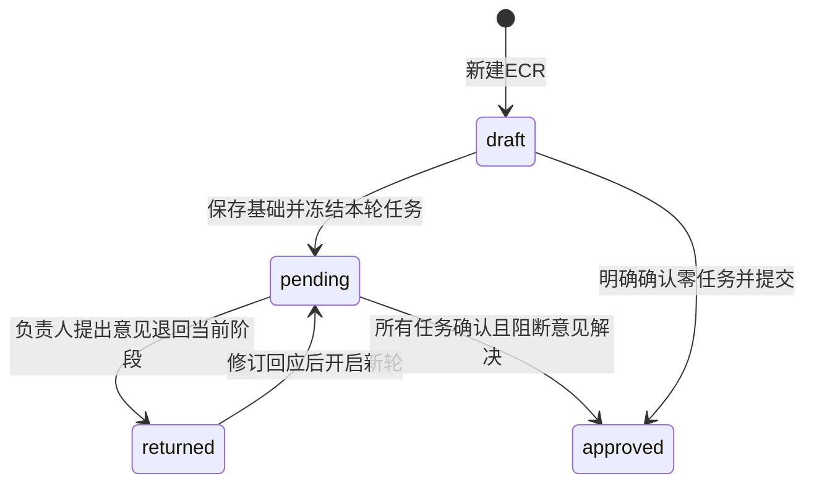

# 可演示MVP：当前规则与已确认后续方案

更新日期：2026-10-12。ECR第一批及五项审查修复已技术交付，用户业务验收待完成；发布和ECO未交付。工作区迁移至0019、25张业务表，本批代码／文档未提交或推送。当前汇总见[README](../README.md)，最新证据见[第一批](testing/ECR-STAGE-2026-10-12.md)和[五项修复](testing/ECR-REVIEW-FIXES-2026-10-12.md)。

## 目标与当前完成边界

目标是在本地用测试账号演示ECR填写、行动处理、退回修订、批准、发布，再基于ECR进入独立ECO并完成发布。演示不以公司真实员工或组织架构为前置条件。

| 范围 | 当前实现 |
| --- | --- |
| 基础表 | 概述、物料与处置、27题、EMC、执行计划、实质性评估及保存恢复已有实现 |
| 新ECR | 负责人分配、问题触发／手工补充任务、按轮处理确认、退回重提、意见复核及阶段自动批准已实现 |
| 旧申请legacy | 原ECR／ECO填写、整单指定审核和历史公开兼容保留，不自动转换 |
| 发布 | 发布人可指定，但操作与published状态未实现 |
| 新ECO | 来源关联、复制创建、独立任务轮次及批准／发布未实现；旧ECO填写页不能替代这些能力 |
| 恢复保护 | 密码清理、历史入口及五项审查修复已实现；已确认任务与原意见历史保留 |

## 当前新ECR流程与权限

申请具有stage标识，现为legacy／ecr；状态仍为draft、pending、returned、approved四种。新ECR的pending显示为处理中；approved是第一批终点，不等于发布。

| 内容或操作 | 当前权限 |
| --- | --- |
| 基础表、人员与补充任务 | 仅发起人在draft／returned编辑；pending／approved锁定 |
| 行动结果、业务状态和日期 | 提交后仅该任务负责人填写当前未确认任务；发起人不能在草稿代填 |
| 本人任务 | 允许发起人承担并确认自己的行动，但不能因此修改锁定基础内容 |
| 退回 | 本轮任务负责人可以退回整个当前阶段；原提出者无任务时仅复核／继续自己的原意见 |
| 原提出者复核 | 改派后职责仍保留，不获得其他任务编辑权限 |
| 正文与历史 | 处理中有权参与者可读所需表单；修订期间正文隔离，任务／意见历史按授权可见 |
| 旧role | 仅兼容旧接口及历史公开范围，不靠动态切换role授予任务权限 |

所有有效账号均可发起本人申请；工作台提供“我的申请”“待我处理”。反馈管理员为独立附加权限，staff／superuser不绕过业务授权。

提交要求标题、ECR编号非空，27题全部回答；回答为是的行动全部纳入，允许补充其他固定行动。所有任务负责人和发布人须有效；清单及负责人按轮冻结，未回答不当作否。零任务须明确确认并记录，再进入批准。

负责人可自动保存结果，但确认是明确操作。说明、完成／不适用状态和业务日期均完整才可确认，不适用也须原因。确认后任务只读；任务业务状态不直接充当批准。

任一退回结束整个轮次。发起人修订并逐条回应后重提；新任务全部重新确认，旧结果仅为待复核初值。原提出者复核自己的意见，全部任务确认且阻断意见解决后自动批准，不再增加整单终审。

## 已确认但尚未实施的第二、三批

第二批由每单指定发布人发布已批准ECR，published与approved分开；发布后ECR只读，由原发起人明确创建一个关联ECO。ECO复制概述、物料／处置、问题、EMC、执行计划和实质性评估作为可修订初值，ECR行动结果只读引用，ECO负责人及执行结果从空开始；使用独立ECO编号，不把来源ECR编号重复保存成新ECR编号。

第三批复用行动任务确认、整阶段退回、新轮重提及意见复核，完成ECO批准／发布、阶段导航和必要待办。上述是已确认方案，不是现有接口能力；源码目前没有eco阶段实例或published状态。

## legacy兼容与共享边界

已有申请均保持legacy。原指定审核要求全部指定人员批准，排除申请者本人；新增公开提交及重提已停用，旧public保留原访问范围和两人批准兼容。legacy的两个行动页可按已保存问题独立填写，没有新阶段发布准入；新ECR拒绝原整单提交／批准以及ECO写入。

正式意见与回应跨轮保留，旧普通留言只读；不提供基础表完整逐轮快照。行动任务另按轮保存结果、版本、负责人及确认时间。源模板法规和适用性结论仍由人填写，不由任务批准自动代替。

非空ECR／ECO编号分别全局唯一，空编号可重复；27题及各61条行动使用稳定标识，一题可对应多条行动。原姓名只读保留，不猜测匹配账号。已有停用账号关联可保留／清除，不能新增派发给停用账号；不增加自动转派机制。

任务保存先确认旧UUID，再写后续修改；迟到GET不退回新缓存。他人任务与意见共同参与离开保护，未知确认仍提供查询／重试及原账号登录；原回执优先于终态判断。未保存提醒不是异常退出后的本地备份，基础表没有通用多人编辑冲突控制。

系统反馈独立于申请，原文只读、可追加，反馈管理员回复和更新状态。任务／意见消息按账号持久已读；本人退回／回应只有一条申请消息，已读不完成业务待办。完整批准／发布广播通知尚未实现。

## 验收与待办

已完成的是技术交付。第一批验收须复核本人及他人任务权限、27题／行动范围／零任务条件、退回修订及新轮确认、意见历史、自动保存和未知结果恢复。五项修复已有18项前端专项、16项MySQL专项及9个隔离页面断言；本轮文档同步不重跑测试，历史全量数量不当作当前全量。

后两批及完整通知、审核框布局、账号文件整合、刷新身份入口和旧A／B清理见[待办](REQUIREMENTS-REFACTOR-TODO.md)。模板B分支、重复Chart B引用、C-2标题及缺少0.1～0.4清单等仍待业务确认。管理员规则维护、导入／导出、统计、完整历史快照及移动端专项继续在当前范围外。正式部署和其他设备同步未完成。

## 历史批次说明

以下保留此前分批确认中的独有规则、模板疑点和证据入口。其中互斥填写员／审核员、公开提交、自由文字留言以及“当前已推送／迁移终点”等文字属于当时快照；当前规则以上文为准。历史“不设置发布”不是纠正后目标流程的永久排除。早期两周安排是当时估算，不是当前剩余工期；分批验证见testing目录。

## 2026-10-03 EMC范围澄清

用户选择B版矩阵填写：填写员仅填本人申请交叉格的标记和说明，参考文字与行列只读。A/B预览、客户端角色切换和模拟保存退出正式流程；EMC 审查已由后续审核批次接入全站审核员按轮权限只读审查，管理员参考定义与规则维护暂不纳入 MVP。当前不授予跨申请访问。此项以本次明确选择为准，原技术方案EMC只读描述为历史设计。

## 2026-10-04 实质性变更评估范围确认

采用一个主表页签＋A～E分组抽屉，七项主表、37题均支持草稿保存恢复。逐题显示原分支提示，各组与最终结论人工填写；组结论在主表和抽屉同步。改答保留结论并提示复核，不强制逐题向导，不删除不适用组的旧填写。原模板疑点保留并标注，不据此自动判断法规性质或关闭完整业务验收。当前实现和待办见README，具体规则来源见FIELD_MAP。

## 2026-10-04 提交批次确认与实现边界

本批第九页集中提交；标题与ECR编号非空为新增提交必填条件，草稿仍可空白，其余沿用已有规则。指定模式至少选一名有效审核员，公开模式至少存在两名有效审核员否则阻止提交；审核选择不随草稿保存，正式确认后锁定。角色分开：原生审核员组成员不能使用填写员功能，该提交批次登录仅显示审核工作台待接入；2026-10-05已接入实际审核工作台，见下一节。身份、提交、锁定和重开恢复已实现，不把指定关联记录或pending状态当作批准流程已完成；当前进度和验证见README。

## 2026-10-05 审核、退回与再次提交确认

审核员查看整份当前表单。个人通过不等于整单已批准：指定模式全部所选人员通过，公开模式两名不同人员通过。pending时任一有权审核员可退回整单，包括已个人通过者；原因必填。退回结束本轮，returned允许本人修订但不能删除申请，审核员不查看修订中的整表。双方可继续追加自由文字反馈。有权审核员通过“退回沟通”进入当前退回轮次，不要求已个人批准；重新提交后旧轮移出该入口。

再次提交默认沿用审核方式／人员但允许更改，重新校验有效账号、标题及ECR等条件，并开启独立新轮；上一轮批准不计入新轮。新轮权限重算，旧人员未获新权限不得看新表单或新反馈；新轮有权人员可看以前意见，旧轮过程只读。保留每轮方式、名单、通过、退回原因和反馈，不保存完整旧表单快照。approved是MVP终点，不再打开。

批准、退回和反馈请求带所查看轮次，过期轮请求409；提交UUID仅确认同一次提交，不能用旧请求开启新轮。所有状态转换及表单保存／反馈共用申请行锁，最后批准与退回先成功完成者生效，另一方冲突刷新。前后端草稿／退回可编辑、待审核／批准只读，审核员始终不具备填写权限。审核请求在途或当前待审核轮次操作结果未确认时，所有表单返回入口应阻止离开，保留查询和原请求重试入口；结果确认后恢复导航。上述流程已技术实现，当前版本业务复验仍待完成。

新增验收：已个人通过者能在pending退回；退回理由为空拒绝；returned八表可修订但禁删，审核员表单GET拒绝；新轮旧批准为零、改名单后旧人员隔离；旧轮写入拒绝；returned交流和历史作者／时间正确；approved不可退回／反馈；重复／并行批准及最终批准与退回竞争正确。

## 2026-10-05 审核意见与系统反馈

审核意见及申请内跨八表入口已实现，技术验证完成，用户业务验收待完成。旧review_feedback和退回原因只读保留，不删除或追认为已解决修改项；普通留言停止新增。独立系统反馈已于2026-10-08接入，审核意见原批次边界见[审核交付](testing/REVIEW-ISSUES-2026-10-05.md)。

### 审核修改意见

- [x] 审核员查看已提交申请，先列多条具体问题，标明所属页签及必要的题号／物料信息；确认后一次性提交意见并退回整单，而非每条立即退回。正式意见保留提出者、申请和审核轮次。
- [x] 填写员在退回后修改表单并逐条回应，标记已处理／待复核；也允许说明不修改的原因后送原提出者复核。填写员不能自行将意见确认解决。
- [x] 有未解决正式意见时，重提不得更换原审核方式／人员。原提出者复核自己的意见，可以确认解决或继续要求修改；重提后仍按新轮重新计算批准。
- [x] 存在未解决正式意见时，整单不得批准；全部意见解决后，指定审核仍要求全部所选人员通过，公开审核仍要求两名不同审核员通过。提出正式意见后的退回、修订、重提及复核过程可追溯，不能因新轮开始丢失未解决项。
- [x] 草稿仍只有本人可访问，提交后审核员才可看授权表单；退回期间审核员可看意见与回应，但不得读取正在修订的正文。历史意见不能成为访问其他申请的入口。

实施补充：所有未解决项逐条回应后才能重提；只能在重提后确认解决，公开审核同样限原提出者；解决不自动计票。原提出者不可用时提示恢复身份，不增加转交。已解决项不重开，需要时另提新意见。升级前无正式意见的旧退回申请仍可按旧条件重提。

### 系统反馈与管理员处理

- [x] 填写员、审核员提交问题／建议／其他类型＋文字反馈，无附件；提交后原文不可修改，用户可追加追问或意见。
- [x] 系统反馈独立于申请及轮次；用户只查看本人反馈和公开处理时间线；管理员可回复及更新状态，关闭或重新打开必须说明。
- [x] 附加“反馈管理员”组授权，不改变原业务身份；superuser／staff不自动获得权限。不增加规则维护及导入／导出。

### 悬浮入口与验收

- [x] 申请内审核意见入口跨八表共用并展示未解决数量。
- [x] 填写员及审核员工作台及申请页面的独立系统反馈悬浮入口，打开不卸载表单，与审核意见抽屉协调显示。
- [x] 上述审核意见链路技术验证通过；测试与真实页面边界见本批记录。
- [ ] 用户人工验收审核意见链路。
- [x] 技术验证两层用户均可提交且只看本人，管理员可查看全部及回复／更新状态；反馈不改变申请或批准结果。用户人工验收待完成。
- [x] 审核意见的正文隔离、跨页输入保护、历史保留、请求重试和并发批准条件技术验证通过。
- [x] 系统反馈的隔离、输入保护及请求恢复技术验证通过，用户人工验收仍待完成，详见系统反馈交付记录。

## 2026-10-08 全局审核提醒

用户确认提醒覆盖审核意见、填写员回应及待审核申请。登录页面首次读取到未读消息时弹窗，统一悬浮入口收起时显示全局未读数量，展开后角标转到审核意见选项。稍后处理和查看消息不标已读；消息列表可直接进入对应申请，原权限及输入保护继续适用。

填写员只接收本人退回申请的回应/修订待办；审核员只接收当前有权轮次的待审核任务和本人意见收到的回应。列表页不再要求先打开申请才能查看消息。支持单项及全部标为已读，按账号保存；清除红点不完成业务待办，新入站意见/回应或轮次再次提醒，普通表单编辑和本人处理不重复提醒。

30秒轮询、聚焦刷新及手工刷新；审核/回应/提交后主动刷新本人数量。技术验证及完整边界见[全局提醒记录](testing/REVIEW-INBOX-2026-10-08.md)及[已读记录](testing/INBOX-READ-2026-10-08.md)，人工业务验收待完成。

## 2026-10-09 系统反馈双向沟通与提醒

用户确认扩展系统反馈：填写员及审核员均可在本人反馈中追问／追加意见；原文只读，追加内容与管理员处理保存在同一时间线。已关闭后追加自动转为处理中。管理员回复／状态更新提醒提交者，用户新建／追加提醒反馈管理员；本人发送不作为新入站提醒。30秒轮询、聚焦及手工刷新；持久已读只清除对应反馈提醒，不改变反馈状态，旧消息版本不能清除新消息。详情页移除类型／状态列表筛选，保留返回列表、刷新详情及已读操作。无附件，反馈独立于申请审核。当前实现与验证见[本批记录](testing/FEEDBACK-CONVERSATION-2026-10-09.md)。
