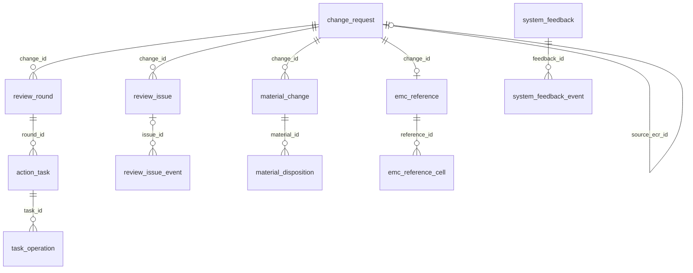

# 完整字段与关系历史快照（0021）

2026-10-13补充：当前迁移0024；下文及Mermaid源保留0021的核对快照，不包含0022多人关联和0023填写人交接，不能作为当前完整数据库结构。

原核对日期：2026-10-13。当批读取Django模型并只读核对本机MySQL列：25张业务表、213个字段、30条业务表间外键。不是其他设备已升级的证明。

完整字段只在[Mermaid源文件](DATABASE-ER-FULL.mmd)维护，含PK／FK／单列UK、实际SQL类型、可空性和生成列；用户外键注明auth_user，不展开账号／权限系统表。结构总览见[代码与数据组](../PROJECT_GUIDE.md#先理解业务数据组)。

0020增加受保护的唯一来源关系及发布证据；0021扩大任务键／状态并增加ECO补充标记，不新增业务表。任务属于轮次，原请求属于任务；业务确认和发布是独立记录。

## 关键关系

## 联合唯一约束

- `change_request`：`(ecr_no_unique)`。
- `change_request`：`(eco_no_unique)`。
- `review_round`：`(change_id, number)`。
- `review_round`：`(change_id, request_id)`。
- `review_record`：`(round_id, reviewer_id)`。
- `action_task`：`(round_id, action_key)`。
- `task_operation`：`(task_id, author_id, request_id)`。
- `review_feedback`：`(round_id, author_id, request_id)`。
- `review_inbox_read`：`(user_id, round_id)`。
- `review_issue_event`：`(change_id, author_id, request_id, position)`。
- `system_feedback`：`(submitter_id, request_id)`。
- `system_feedback_read`：`(user_id, feedback_id)`。
- `system_feedback_event`：`(feedback_id, request_id)`。
- `material_change`：`(change_id, request_id)`。
- `material_disposition`：`(material_id, location_item)`。
- `question_response`：`(change_id, number)`。
- `ecr_action_response`：`(change_id, action_key)`。
- `eco_action_response`：`(change_id, action_key)`。
- `execution_plan_response`：`(change_id, activity_key)`。
- `significant_chart_response`：`(change_id, chart_key)`。
- `significant_question_response`：`(change_id, question_key)`。
- `emc_reference_row`：`(reference_id, key)`。
- `emc_reference_row`：`(reference_id, id)`。
- `emc_reference_test`：`(reference_id, key)`。
- `emc_reference_test`：`(reference_id, id)`。
- `emc_reference_cell`：`(row_id, test_id)`。

## EMC复合外键

cell(reference_id,row_id)和cell(reference_id,test_id)分别关联row／test的(reference_id,id)，防止跨参考填写。普通外键和每单行列结构见完整源文件；日期、状态、阶段及版本检查以models与迁移为准。

## 历史图像

[0017 Mermaid快照](DATABASE-ER-0017.mmd)、[旧SVG](images/DATABASE-ER-FULL.svg)、[旧PNG](images/DATABASE-ER-FULL.png)保留当时23表／186字段结构，未冒称当前0021图；本页及Mermaid源文件均为0021快照；当前完整结构以models.py及迁移为准。历史系统表／复合外键核对见[当批记录](../testing/SYSTEM-FEEDBACK-2026-10-08.md)。
