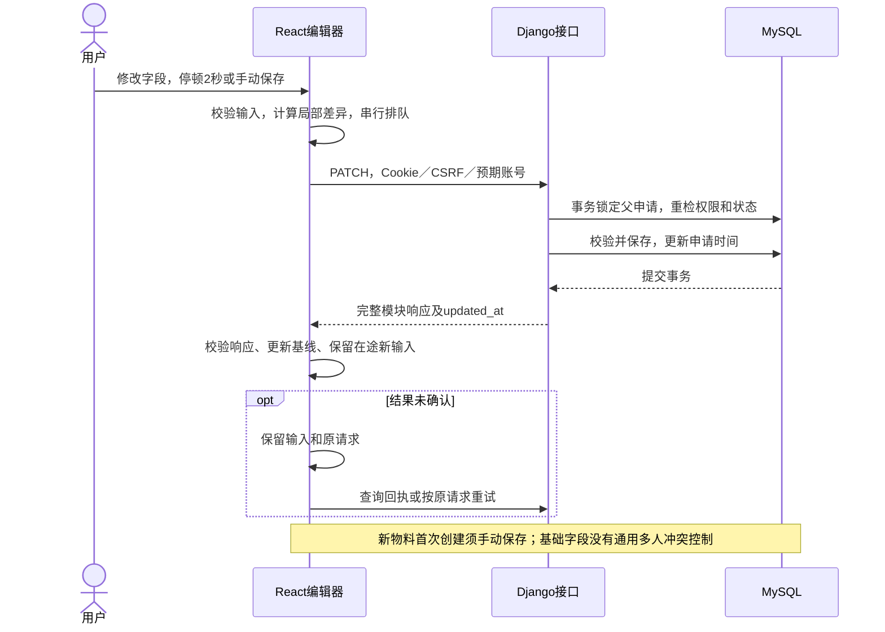
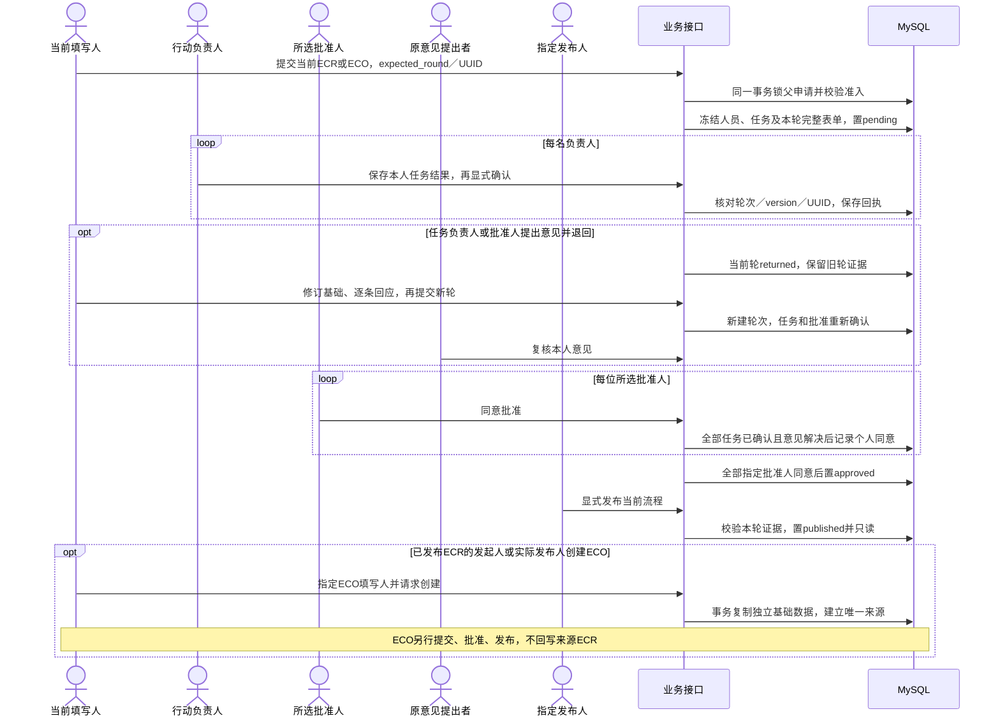

# 当前保存与ECR／ECO流程序列

更新日期：2026-10-20，依据0027代码。规则见[MVP](../MVP.md)，授权与数据职责见[项目指南](../PROJECT_GUIDE.md)。

## 保存与恢复

查询只读取已有结果，不补发写入。请求未发送时查不到原回执，需原请求重试才会提交；实际已执行但回包丢失时，查到原凭据即可恢复。成功响应结构不完整时保留输入及原请求，不能仅凭HTTP 200更新保存基线。普通字段保存可有限重试，批准／发布等业务确认不自动重放。

## 两阶段独立流转

指定发布人的权限由后端决定；待发布消息、“待我发布／已发布”及工程变更现已统一进入当前流程总览发布区，是否为发起人不改变权限。批准／退回历史读取本轮快照，不能替换为正在修订的实时正文。ECO创建不会修改已发布来源ECR的时间戳，迟到读取合并时须保留既有ECO关联及创建回执；条件已变时停止不能继续的原请求，不伪报原操作成功。

独立系统反馈另有提交、追加、公开处理及已读链路，不调用上述业务批准／发布动作。界面见[线框图](../线框图1.4.drawio)第17页，规则见[MVP](../MVP.md#独立系统反馈与反馈管理)，恢复与版本回归见[关键回归](../testing/REGRESSIONS.md)。
