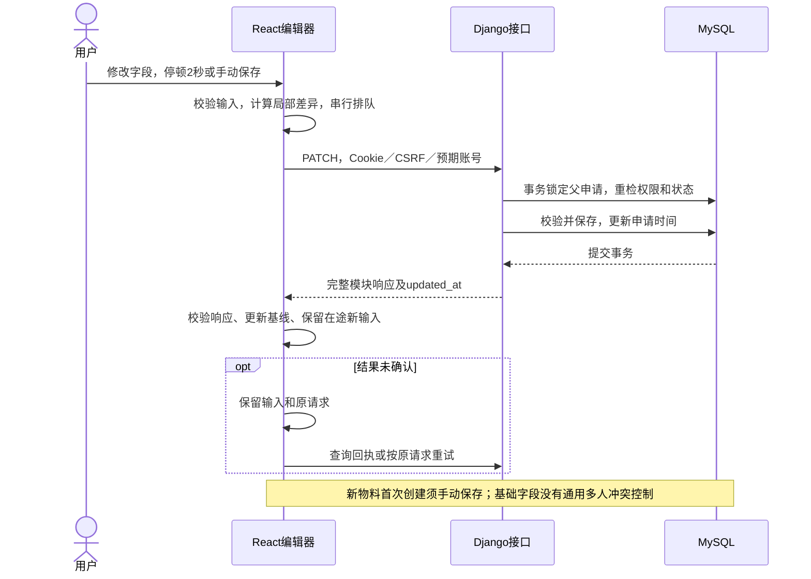
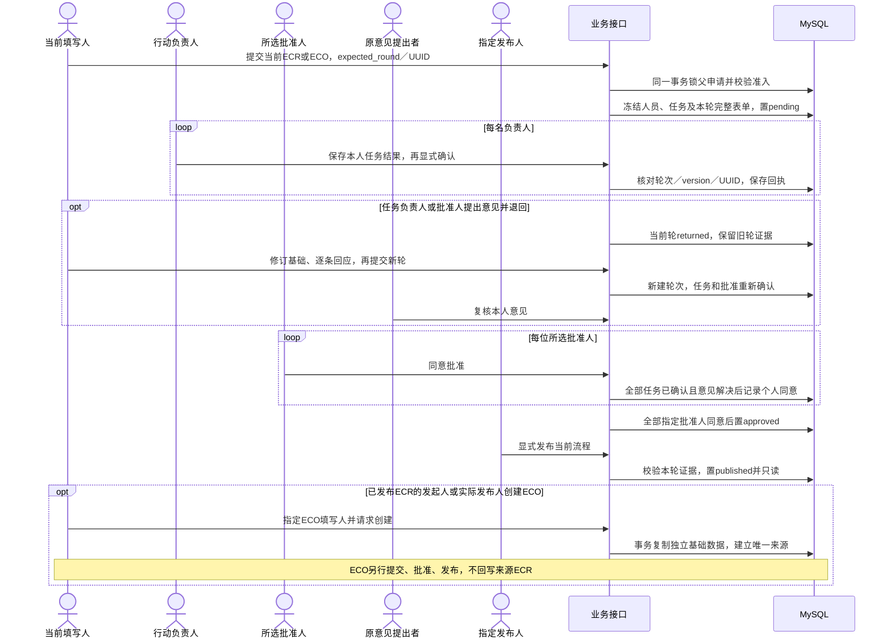

# 当前保存与ECR／ECO流程序列

更新日期：2026-10-16，依据0027代码。规则见[MVP](../MVP.md)，授权与数据职责见[项目指南](../PROJECT_GUIDE.md)。

## 保存与恢复

## 两阶段独立流转

指定发布人的权限由后端决定；当前消息／待我发布入口缺少发布区的问题仍见[待办](../REQUIREMENTS-REFACTOR-TODO.md)。批准／退回历史读取本轮快照，不能替换为正在修订的实时正文。
