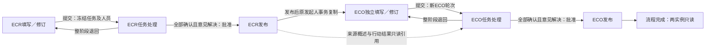

# ECR至ECO阶段与权限（2026-10-13）

对应当前0021实现，25张业务表。技术交付完成，用户业务验收待完成；旧ER／序列图及图片继续作为历史快照。

## 六阶段进度

approved表示等待指定发布人操作；published表示发布完成。退回使本轮停止，新轮全部重新确认；旧轮确认不计入修订进度。零任务明确确认后跳过任务处理进入批准，仍须显式发布。

## 人员与来源边界

| 内容 | 授权及行为 |
| --- | --- |
| 基础表、任务范围、负责人、发布人 | 发起人仅draft／returned编辑；提交后锁定 |
| 任务填写／确认 | 指定负责人处理自己的当前未确认任务，允许本人任务 |
| 实施阶段完成 | 可以保存，不能确认；完成／不适用须说明及日期完整 |
| 退回／回应／复核 | 任务负责人退回本阶段；发起人逐条回应；原提出者复核，改派后保留职责 |
| 发布 | 每个实例自己的有效指定发布人，仅approved可操作，不能撤销 |
| ECO来源 | 基础数据独立复制；ECR结果只读引用；仅ECO参与者看来源概述与结果，不获得完整ECR历史权限 |
| 相邻阶段导航 | 仅有正文权限时开放；无权阶段隐藏编号／任务／历史，退回参与者走意见和历史入口 |

当前导航通过stage-navigation返回六节点摘要；source-ecr仅提供来源发布概述。旧轮任务和意见有独立访问校验，导航不是额外授权。

## 必要待办

任务未确认、退回修订、原作者复核和指定发布人待发布按当前阶段／轮次汇总；本人事项去重。已读只清提醒，不确认任务或执行发布；批准后出现待发布，发布后退出待办。完成广播通知不属于本批。

验证及数据保护边界见[第三批记录](../testing/ECO-STAGE-NAVIGATION-2026-10-13.md)。
